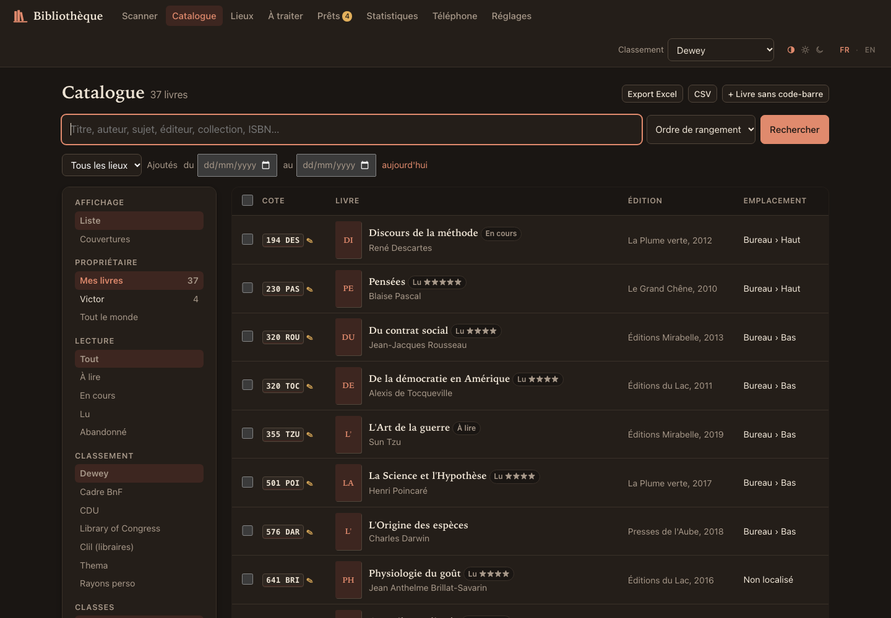
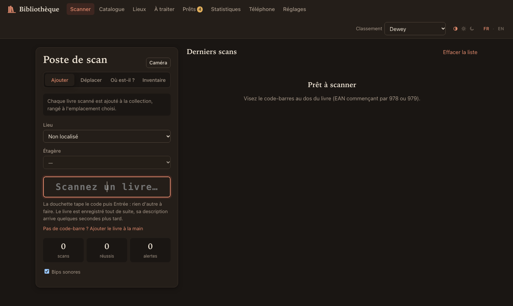
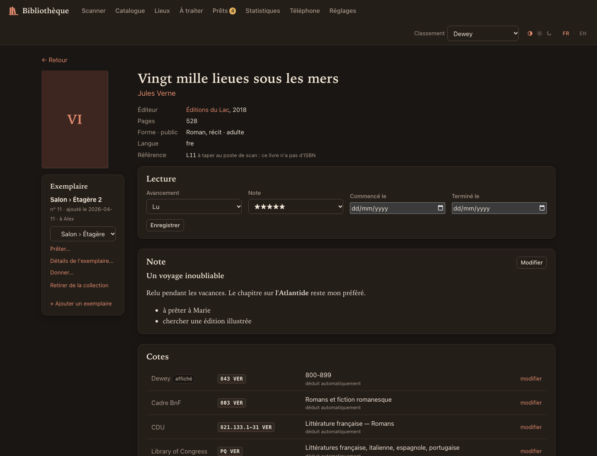
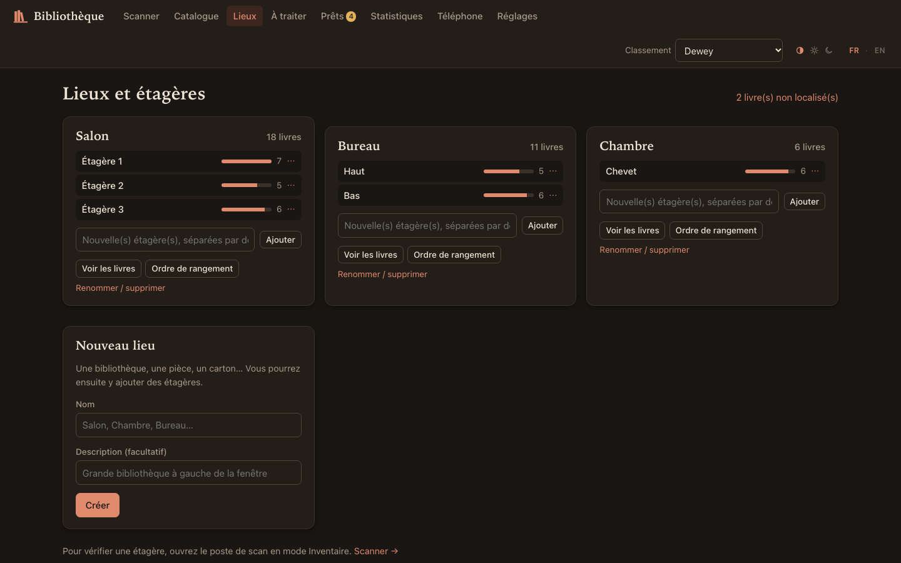
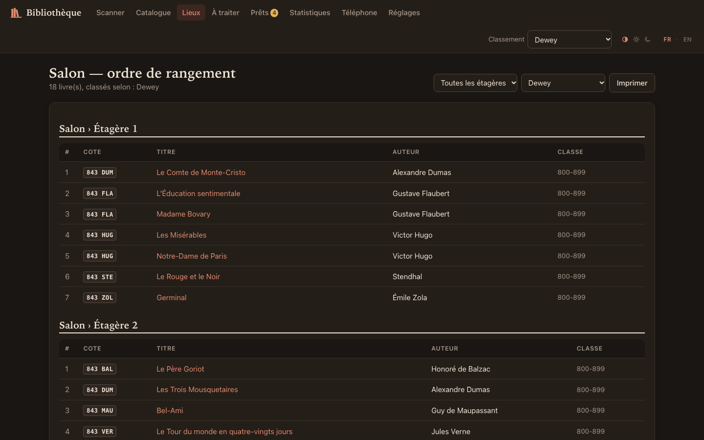
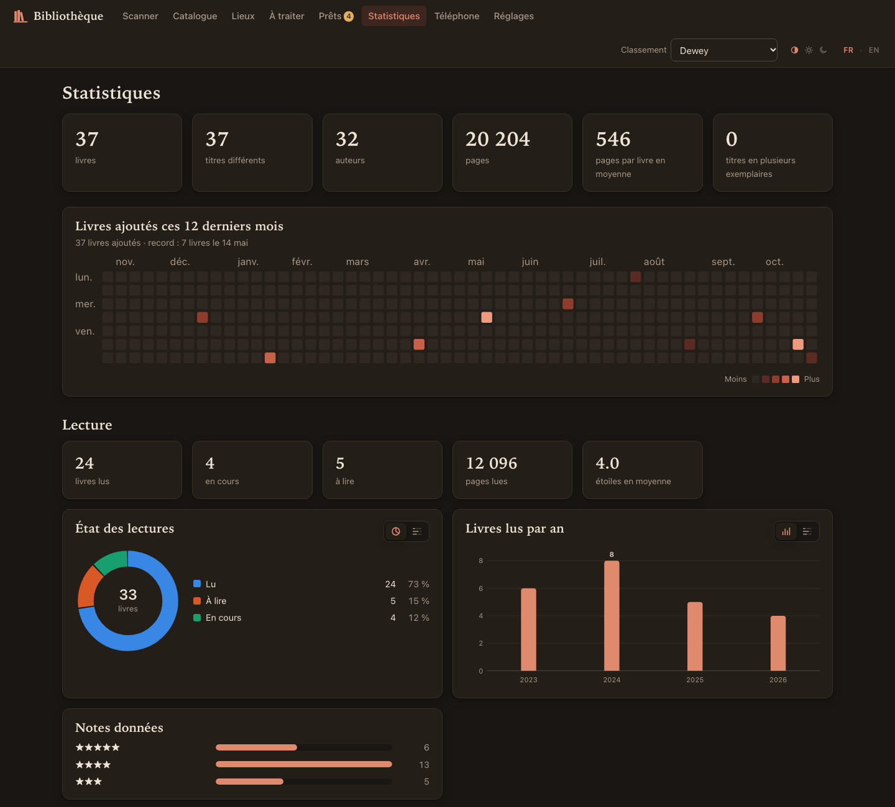
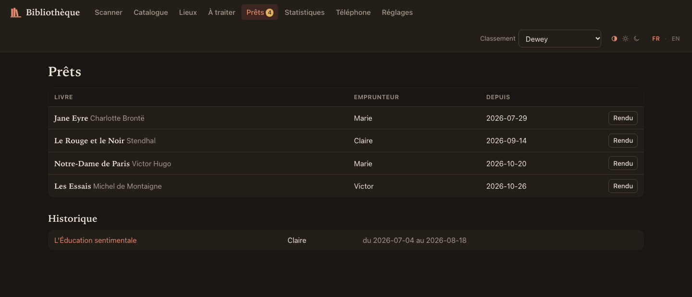

# Bibliothèque

[English](README.md) · **Français**

Logiciel de bibliothèque personnelle : on scanne les livres à la douchette, ils sont
décrits automatiquement, localisés (Salon › Étagère 2…) et cotés dans sept systèmes
de classement. Appli web locale pour scanner et consulter, CLI pour tout le reste.
Conçu pour macOS, Linux et Windows (testé sur macOS ; Linux et Windows pas encore essayés).

Tout est détaillé dans la **[documentation complète](DOCUMENTATION.fr.md)**.

## Aperçu

Captures réalisées avec une base de démonstration : œuvres du domaine public, éditeurs et personnes inventés.



| | |
|---|---|
|  |  |
| **Scanner** à la douchette ou avec la caméra du téléphone | **Fiche** : lecture, notes en Markdown, cotes dans chaque système |
|  |  |
| **Lieux** : pièces et étagères | **Rangement** : la liste à suivre, étagère par étagère, imprimable |
|  |  |
| **Statistiques** : ajouts, lectures, notes | **Prêts** : qui a quoi, depuis quand |

## Installation

Il faut seulement **uv**, le gestionnaire Python d'Astral : il installe lui-même la bonne
version de Python (3.12 ou plus) et les dépendances au premier lancement.

### macOS

```bash
curl -LsSf https://astral.sh/uv/install.sh | sh
```

Puis, dans le dossier du projet :

```bash
./biblio.sh serve
```

`sqlite3` (pour `biblio sql`) est déjà installé sur macOS.

### Linux

```bash
curl -LsSf https://astral.sh/uv/install.sh | sh
```

```bash
./biblio.sh serve
```

Pour `biblio sql`, installez `sqlite3` si besoin (`sudo apt install sqlite3`, ou `sudo dnf install sqlite`).
Pour scanner au téléphone avec un pare-feu actif, ouvrez les ports du mode téléphone :

```bash
sudo ufw allow 8443,8080/tcp
```

### Windows

Dans PowerShell :

```powershell
winget install --id=astral-sh.uv -e
```

Rouvrez le terminal, puis dans le dossier du projet :

```powershell
.\biblio.cmd serve
```

Pour `biblio sql` : `winget install SQLite.SQLite` (facultatif). Au premier `serve --phone`,
le pare-feu Windows Defender demande d'autoriser Python : cochez **Réseaux privés**.

### Raspberry Pi (serveur permanent)

Service systemd, base hors du partage réseau, copies quotidiennes sur disque externe, ports
choisis pour ne pas gêner les autres services : voir [deploy/README.fr.md](deploy/README.fr.md).

### Sur tous les systèmes

- Le navigateur s'ouvre sur http://localhost:8000.
- Les lanceurs `./biblio.sh` (macOS, Linux) et `biblio.cmd` (Windows) rangent l'environnement
  Python hors du projet, dans `~/.virtualenvs/uv/bibliotheque`. C'est utile quand le dossier est
  synchronisé (OneDrive, Dropbox…). Sans lanceur, `uv run biblio serve` marche aussi : uv crée alors
  un dossier `.venv` dans le projet.
- Toute commande de ce README s'écrit `./biblio.sh …` ou `biblio.cmd …` ; elles sont notées
  `biblio …` plus bas.
- Données propres à l'ordinateur (certificats du mode téléphone) : `~/Library/Application Support/biblio`
  (macOS), `%LOCALAPPDATA%\biblio` (Windows), `~/.local/share/biblio` (Linux).

Premiers pas :
1. **Lieux** : créez vos bibliothèques (Salon, Chambre…) et leurs étagères.
2. **Scanner** : choisissez le lieu et l'étagère, puis scannez à la chaîne.
3. **À traiter** : complétez les rares livres introuvables.
4. **Catalogue** : cochez des livres (Maj+clic pour une plage, ou « sélectionner tous les résultats »
   d'une recherche) pour les ranger d'un coup, les donner ou les retirer. Filtres utiles : lieu
   « Non localisés », et « Ajoutés du … au … » (lien « aujourd'hui »).

**Thème** : en haut à droite, à côté de **FR · EN**, trois petites icônes : automatique (suit le
réglage clair/sombre de l'appareil), clair, sombre. Le choix est propre à chaque appareil :
l'ordinateur et le téléphone peuvent avoir chacun le leur.

## Livres sans code-barre

- **Un ISBN est imprimé** (souvent au verso de la page de titre, pour les livres des années 1970-2000) :
  tapez-le dans le champ du poste de scan, comme si la douchette l'avait lu.
- **Pas d'ISBN** (livres anciens, autoédités) : lien « Pas de code-barre ? » sous le champ de scan, ou
  Catalogue › « + Livre sans code-barre ». La page propose :
  1. une **recherche à la BnF** par titre, auteur et année. Choisir un résultat crée une fiche complète et
     cotée, sans autre requête ;
  2. une **saisie complète à la main** (tous les champs), qui ne dépend jamais de la BnF : si elle ne
     trouve rien ou ne répond pas, le titre et l'auteur tapés sont recopiés et le livre est enregistré
     tel quel. « Ajouter et en saisir un autre » enchaîne les livres au même emplacement.
- En ligne de commande : `biblio manual` (recherche BnF puis liste numérotée ; `--no-search` pour tout
  saisir à la main). Le livre reçoit une référence (`L12`), à taper au poste de scan comme un ISBN.

## Notes

Chaque fiche a une **note personnelle en Markdown** (titres, **gras**, listes, liens, citations…),
affichée mise en forme et modifiable sur place. Les notes sont cherchables depuis le catalogue,
et ne sont jamais incluses dans un fichier partagé. CLI : `biblio note 978… [--edit]`.

## Lecture et détails d'un exemplaire

Sur la fiche, tout est vide tant que vous ne le remplissez pas, et rien de tout cela n'est jamais partagé :

- **Lecture** : à lire, en cours, lu ou abandonné, dates de début et de fin, note de 1 à 5 étoiles. Le catalogue
  filtre par état (votre pile à lire), et les statistiques suivent vos lectures. CLI :
  `biblio read 978… --status read --rating 4 --finished 2026-10-30`.
- **Exemplaire** : état, prix et date d'achat, provenance, dédicace, valeur estimée, note. Les statistiques donnent
  la valeur de la collection. CLI : `biblio copy 12 --condition good --price 7,50 --from Gibert`.

`biblio duplicates` liste vos livres en plusieurs exemplaires, tous lieux confondus. `--remove` retire les
exemplaires de trop au même emplacement, après une copie de la base ; un exemplaire renseigné n'est jamais retiré.

## Propriétaires, dons et catalogues d'amis

Chaque exemplaire a un **propriétaire**. Vos livres portent votre nom (Réglages, ou
`biblio config proprietaire JD`). Une personne est reconnue à son identité, pas à son nom : « victor » et
« Victor » sont la même, et un ami qui change de nom reste la même personne.

- **Don** : Catalogue › cochez des livres › « Donner à… », ou sur la fiche › « Donner… ». Un don
  change seulement le propriétaire : il clôt un prêt en cours, et le livre quitte vos étagères.
  Recevoir un livre se fait de la même façon (« Changer de propriétaire… » › votre nom) : il arrive
  non localisé, prêt à être rangé. Pour un prêt, rien ne change : « Prêter… ».
- **Le catalogue d'un ami** : il vous envoie un fichier, vous l'importez, puis le filtre **Propriétaire**
  du catalogue (Mes livres / Victor / Tout le monde) permet de voir s'il a le livre que vous cherchez,
  et où (« chez Victor — Salon › É2 »), s'il n'a pas masqué ses lieux. Par défaut, le catalogue, les
  statistiques et « À traiter » ne montrent que vos livres.

Exemple complet entre Victor et vous (Victor utilise aussi ce logiciel) :

```bash
# Chez Victor : un fichier avec ses livres, sans dire où ils sont rangés
biblio share -o pour-alex.db --hide-places
```

```bash
# Chez vous : on l'ajoute (aperçu, puis confirmation)
biblio merge pour-alex.db --as Victor
```

```bash
# Plus tard, avec un fichier plus récent : met à jour, et retire les livres que Victor n'a plus
biblio merge pour-alex.db --as Victor --replace
```

Le fichier de partage se télécharge aussi depuis Réglages › « Partager avec un ami » (choix des lieux,
case « masquer les lieux »). Il contient les fiches, les cotes et les réponses des catalogues (l'ami
n'a rien à retélécharger), mais **jamais** vos notes, vos lectures, les détails de vos exemplaires, votre clé
Google, la clé du téléphone ni vos réglages. Vos prêts n'y sont que si vous le demandez (`--with-loans`, ou la case de Réglages) : ils
contiennent le nom des emprunteurs, et relient alors vos amis dans le réseau des prêts des Statistiques.

**Scanner soi-même les livres d'un ami** : scannez-les dans une base à part, puis importez-la.
Ses lieux et ses livres ne se mélangent ainsi jamais aux vôtres, et cette base pourra devenir la sienne.

```bash
# 1. Créer sa base, à son nom (serveur habituel arrêté)
BIBLIO_DB=data/victor.db ./biblio.sh config proprietaire Victor
```

```bash
# 2. Scanner chez lui : créer ses lieux, puis scanner comme d'habitude
BIBLIO_DB=data/victor.db ./biblio.sh serve --phone
```

```bash
# 3. Une fois le serveur arrêté, ajouter ses livres à votre base
./biblio.sh merge data/victor.db
```

Au téléphone, rescannez le QR code « Scanner » : la clé est propre à chaque base. Détails, douchette à
mémoire, lieux masqués, Windows et erreurs courantes :
[Scanner la bibliothèque d'un ami](DOCUMENTATION.fr.md#13-scanner-la-bibliothèque-dun-ami).

**Deux ordinateurs** : chaque machine a sa base, et `biblio sync` les réunit. Lancez-le des deux côtés.

```bash
./biblio.sh sync /chemin/vers/l-autre/biblio.db
```

La première fois, la commande demande de confirmer que cette base est bien à vous. Ajouts, déplacements,
retraits, prêts, notes, lectures, corrections et lieux renommés se propagent ; pour chaque donnée, la
modification la plus récente l'emporte. [Toutes les règles](DOCUMENTATION.fr.md#synchroniser-deux-ordinateurs).

Deux commandes, deux besoins :

| | `biblio merge` : le catalogue d'un ami | `biblio sync` : mes deux ordinateurs |
|---|---|---|
| Les livres | restent les siens | sont les miens |
| Vos livres | jamais modifiés | mis à jour, ou retirés |
| Données personnelles | jamais reprises | reprises |
| En cas de conflit | vos corrections gardées | la plus récente gagne |

Règles communes : une erreur ne laisse rien à moitié fait, fusionner deux fois le même fichier ne crée aucun
doublon, `--dry-run` montre ce qui changerait, et la base est copiée avant (`data/biblio-avant-fusion.db`,
`data/biblio-avant-synchro.db`).

## La douchette

Elle se comporte comme un clavier : elle tape le code puis Entrée. Rien à installer.
- Le champ de scan garde le focus. Bip aigu = ajouté, double bip = déjà possédé ou mal rangé, bip grave = erreur.
- **Douchette en QWERTY sur Mac AZERTY** : les chiffres arrivent en `çè&é…` ; c'est corrigé automatiquement.
- Le code prix collé à l'EAN (5 chiffres de plus) est ignoré, et une double lecture accidentelle aussi.
- Si votre douchette a un **mode mémoire** (scan sans ordinateur), exportez le fichier puis :
  `biblio import codes.txt --place "Salon/É1"`.

### Douchette sans fil

La version filaire fonctionne, mais une douchette sans fil marche **sans rien changer** ici.
Ce qu'il faut regarder :
- **mode clavier (HID)** : elle « tape » le code comme la douchette actuelle ;
- **dongle USB 2,4 GHz** plutôt que Bluetooth seul : aucun appairage, connexion plus stable sur Mac
  (beaucoup de modèles font les deux) ;
- **mode mémoire / inventaire** : on scanne loin de l'ordinateur, puis on vide la mémoire avec `biblio import` ;
- disposition clavier réglable (sinon la correction AZERTY s'en charge) et suffixe « Entrée » ;
- un lecteur 1D (laser ou CCD) suffit pour les EAN des livres ; un 2D lit aussi les QR codes.

## Scanner avec le téléphone

```bash
./biblio.sh serve --phone
```

Puis, sur l'ordinateur, page **Téléphone** (ou `biblio phone` dans le terminal) :
1. **Première fois**, QR code 1 : installe sur le téléphone le certificat de la bibliothèque
   (iPhone ou Android, les instructions s'affichent). Nécessaire car le navigateur n'ouvre la
   caméra que sur une connexion chiffrée.
2. **Pour scanner**, QR code 2 : ouvre le poste de scan avec la caméra **en plein écran**.
   Touchez l'écran pour commencer (active les bips et garde l'écran allumé), puis visez les
   codes-barres : bip, flash vert/orange/rouge, vibration (Android), et le dernier livre s'affiche
   en bas avec sa cote. En-tête : mode et emplacement, à toucher pour les changer. Icônes : lampe,
   changer de caméra, sortir du plein écran, fermer ; flèche « annuler » sous le dernier ajout.
   Tous les modes marchent (ajout, déplacement, « où est-il ? », inventaire).
3. **Vrai plein écran sur iPhone** : depuis la page de scan dans Safari ou Firefox, Partager ›
   « Sur l'écran d'accueil ». L'icône « Bibliothèque » ouvre alors le scan sans aucune barre.

Les bips sonnent même en mode silencieux (une musique en cours peut se mettre en pause) ;
case « Bips sonores » pour les couper.

Détails :
- Téléphone et ordinateur sur le même Wi-Fi. Au premier lancement, le pare-feu demande d'autoriser
  Python à accepter les connexions entrantes : acceptez (macOS ; Windows : « Réseaux privés » ;
  Linux : voir Installation).
- **Sécurité** : le QR code 2 contient une clé secrète ; sans elle, un autre appareil du réseau ne
  voit rien. Page Téléphone › « Changer la clé » (ou `biblio phone --new-key`) coupe
  l'accès des téléphones déjà connectés. Le serveur d'installation (port 8080) ne sert que le
  certificat.
- Les certificats et la clé privée de l'autorité locale sont rangés hors du projet, dans le dossier
  `certs/` des données de l'ordinateur (voir Installation) ; le certificat du serveur se renouvelle seul
  (changement d'adresse IP, expiration) sans rien réinstaller sur le téléphone.
- Ports utilisés : 8000 (ordinateur), 8443 (téléphone, HTTPS), 8080 (installation). Les deux derniers se changent
  avec `serve --phone-port … --install-port …` (ou `BIBLIO_PORT_HTTPS` / `BIBLIO_PORT_INSTALLATION`).
- Le décodage des codes-barres se fait dans le téléphone : natif sur Android (Chrome), sinon
  `zxing-wasm` embarqué dans `biblio/web/static/vendor/` (aucun service externe).

**Coupure réseau** : un scan qui n'atteint pas le serveur reste gardé sur l'appareil, puis part tout seul, dans
l'ordre, au retour de la connexion (annonce à l'écran, bouton « Annuler » sur chacun). Les scans gardés survivent
à la fermeture de la page, mais il faut que la page soit déjà ouverte pour continuer à scanner hors connexion.

Modes du poste de scan : **Ajouter**, **Déplacer** (le livre rejoint l'emplacement choisi),
**Où est-il ?**, **Inventaire** (on scanne une étagère ; le rapport liste les absents, les
livres d'ailleurs et les inconnus, et peut tout remettre en ordre).

## D'où viennent les descriptions

Aucun quota journalier : chaque catalogue est interrogé au rythme poli d'environ une
requête par seconde, en arrière-plan. Comptez 4 à 7 secondes par livre, soit 2 à 4 heures
pour 2 000 livres. Le scan n'attend jamais le réseau.

| Source | Rôle |
|---|---|
| **BnF** (catalogue général, UNIMARC) | Source principale pour les livres français. Fournit le Dewey des documentaires et le « cadre de classement » pour la fiction. |
| **Open Library** | Couvertures, livres anglophones, Dewey et LCC complémentaires. |
| **Library of Congress** | LCC et Dewey des livres non français. |
| **Google Books** | Facultatif, seulement avec une clé API gratuite (Réglages). Sans clé, son quota anonyme est saturé : c'est probablement ce qui bloquait autrefois. |

Chaque réponse brute est conservée (table `raw_responses`). On ne réinterroge donc jamais
un ISBN, et l'on peut recalculer toutes les fiches et cotes sans réseau
(`biblio reclassify --reread`). Les couvertures sont téléchargées une fois dans `data/covers/` ;
si un catalogue n'a pas d'image, le suivant est essayé (`biblio covers --missing` réessaie les livres sans image).

## Les systèmes de classement

Toutes les cotes sont calculées et stockées pour chaque livre : changer de système
(menu « Classement ») est instantané.

| Système | Usage | Origine de la cote |
|---|---|---|
| **Dewey** (défaut) | Bibliothèques publiques | BnF/Open Library pour les documentaires. Pour romans, BD et jeunesse (la BnF ne les indexe pas en Dewey) : déduite de la langue d'origine et du genre (roman français = 843, traduit de l'anglais = 823, BD = 741.5, jeunesse = « J 843 »). |
| **Cadre BnF** | Bibliographie nationale française | Fourni par la BnF ; proche des rayons d'une librairie. |
| **CDU** | Belgique, Suisse, CDI | Déduite du Dewey (821.133.1-31 = roman français). |
| **LCC** | Bibliothèques universitaires anglo-saxonnes | Cote complète pour les livres anglophones ; sinon sous-classe déduite. |
| **Clil** | Libraires français | **Déduit** (famille › sous-famille) : le code Clil officiel est diffusé par Electre/Dilicom, services payants. |
| **Thema** | Commerce international du livre | **Déduit**, grandes catégories. |
| **Rayons perso** | Votre propre système | Règles modifiables dans `rules/rayons.toml`. |

Les intitulés officiels de la Dewey appartiennent à OCLC et ne sont pas fournis : les livres sont regroupés par tranche de centaines (`800-899`). Pour afficher vos propres intitulés, ajoutez une table `[libelles]` dans `rules/dewey.toml`, puis lancez `biblio reclassify`.

La cote suit l'usage des bibliothèques : indice + 3 premières lettres de l'auteur (`843 CAM`).

**Corriger** : sur la fiche d'un livre, chaque cote peut être fixée à la main, et chaque
champ corrigé (titre, forme, public…) est protégé des mises à jour automatiques.

**Adapter les règles** : tout est dans `rules/*.toml` (tables Dewey, CDU, LCC, règles
Clil/Thema/rayons, listes de mots-clés). Après modification : `biblio reclassify`
ou Réglages › « Recalculer toutes les cotes ».

Limite connue : pour les romans français, la BnF ne donne pas le sous-genre (policier,
SF…). Il est deviné à partir de la collection (Série noire, Folio SF…) et des sujets
Open Library, donc imparfait. Corrigez à la main ou enrichissez `rules/mots.toml`.

## La CLI (« le cœur du réacteur »), en anglais

La ligne de commande est entièrement en anglais (commandes, options, messages).
L'interface web, elle, est en français par défaut, ou en anglais : Réglages, ou le
petit sélecteur **FR · EN** en haut à droite de chaque page.

```bash
./biblio.sh --help
```

(`biblio.cmd --help` sous Windows.)

| Commande | Rôle |
|---|---|
| `place add Salon` · `place shelf Salon É1 É2` · `place list` · `place rename` · `place remove` | Lieux et étagères |
| `scan --place "Salon/É1"` | Scanner dans le terminal (`:place`, `:mode move`, `:undo`, `:q`) |
| `import codes.txt --place Salon` | Importer une liste d'ISBN |
| `resolve [--retry]` | Décrire les livres en attente / réessayer les introuvables |
| `search camus [--since 2026-10-31] [--owner Victor\|all] [--reading to-read]` · `where 9782070360024` · `show 978…` | Rechercher, localiser, tout voir |
| `list --system rayon --place Salon` | Ordre de rangement |
| `edit 978… --form fiction --audience adulte` | Corriger une fiche |
| `classify 978… dewey 843.914` | Imposer une cote (sans valeur : revenir à l'automatique) |
| `move 978… "Chambre/É2"` · `inventory "Salon/É1"` | Ranger, vérifier |
| `lend 978… Marie` · `return 978…` · `loans` | Prêts |
| `give 978… Victor` · `owners` | Donner un livre, voir les propriétaires |
| `share -o fichier.db [--hide-places] [--place Salon] [--with-loans] [--force]` · `merge fichier.db [--as Victor] [--replace] [--dry-run]` | Partager, importer le catalogue d'un ami |
| `sync autre.db [--dry-run]` | Réunir mes bases de deux ordinateurs |
| `read 978… [--status …] [--rating …] [--started …] [--finished …]` · `copy N° [--condition …] [--price …] [--from …]…` | Lecture, détails d'un exemplaire |
| `note 978… [--edit]` | Note Markdown d'un livre |
| `manual [--no-search]` · `remove <n° d'exemplaire>` | Livre sans code-barre, retirer un exemplaire |
| `system rayon` · `config google_api_key …` · `config langue en` · `config proprietaire JD` | Réglages |
| `reclassify [--reread]` · `covers [--missing]` | Recalculs sans réseau, couvertures manquantes |
| `backup [--dir DOSSIER] [--keep N]` | Copie de sécurité de la base |
| `serve [--phone]` · `phone [--new-key] [--admin]` | Appli web, scan au téléphone, QR codes, clé admin (serveur) |
| `todo` · `stats` · `export --format xlsx` | À traiter, chiffres, export Excel (une feuille par lieu) |
| `sql` · `sql "select …"` | Shell SQLite direct |

## Données

- Base : `data/biblio.db` (SQLite). Tables principales : `personnes` (propriétaires, emprunteurs),
  `notices` (le livre, avec ou sans ISBN, la note et la lecture), `exemplaires` (l'objet, son propriétaire, son lieu,
  ses détails), `classifications` (une cote par système), `raw_responses` (réponses des catalogues), `lieux`,
  `etageres`, `mouvements`, `inventaires`, `prets`, `suppressions` (ce que la synchronisation ne doit pas faire revenir).
- **Sauvegardes** : `biblio serve` copie la base dans `data/sauvegardes/` une fois par jour, et `biblio backup`
  le fait à la demande. Les 14 dernières copies sont gardées. Ce sont elles qu'il faut restaurer :
  [comment faire](DOCUMENTATION.fr.md#sauvegarder).
- Un dossier synchronisé (OneDrive…) n'est pas une sauvegarde : pendant l'utilisation, la base vit dans trois
  fichiers que la synchronisation copie séparément. N'ouvrez pas l'appli sur deux ordinateurs en même temps, et
  attendez la fin de la synchronisation avant de changer de machine.
- `BIBLIO_DB=/autre/chemin.db biblio …` permet d'utiliser une autre base (essais). Sous Windows :
  `$env:BIBLIO_DB = "C:\chemin\essai.db"` (PowerShell) avant la commande.
- Structure de la base : le logiciel est en développement, aucune ancienne version n'est maintenue. Il refuse
  d'ouvrir une base d'une autre version, sans la modifier.

## Tests

```bash
uv run pytest
```

Sans réseau : les parseurs sont testés sur de vraies réponses enregistrées dans `tests/fixtures/`.

## Licence

Copyright © 2026 les contributeurs de biblio.

Ce logiciel est libre, sous licence **GNU AGPL-3.0 ou ultérieure** (voir [LICENSE](LICENSE)). Si vous le
modifiez et le proposez à d'autres par un réseau, vous devez leur donner accès au code source de votre version.

Composants tiers : voir [`LICENCES.txt`](biblio/web/static/vendor/LICENCES.txt).

Les classifications restent la propriété de leurs titulaires, et la licence ci-dessus ne concède aucun droit
sur elles : Dewey, Dewey Decimal Classification et DDC sont des marques d'OCLC ; Thema relève d'EDItEUR, la CDU
de l'UDC Consortium, la Clil de la Commission de liaison interprofessionnelle du livre, le cadre de classement
de la BnF et la LCC de la Library of Congress. Ce projet n'est affilié à aucun de ces organismes. Les tables de
`rules/` sont des correspondances approximatives : elles ne remplacent pas les éditions officielles.
