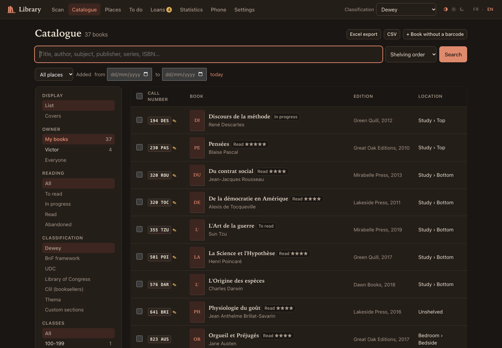
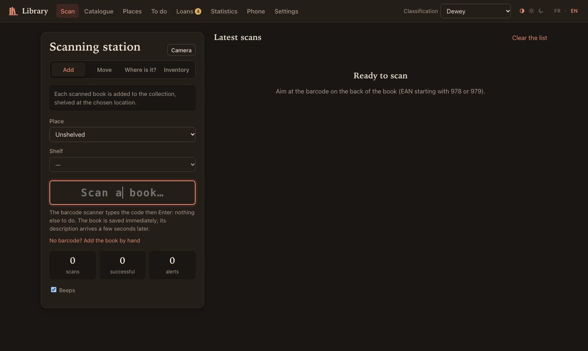
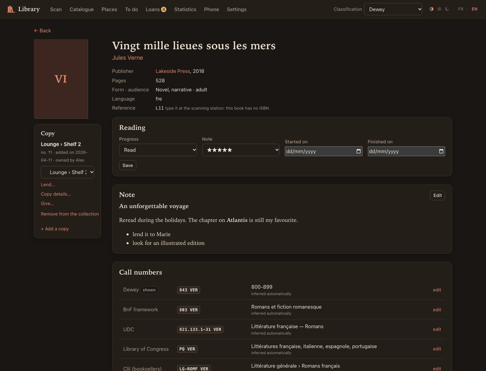
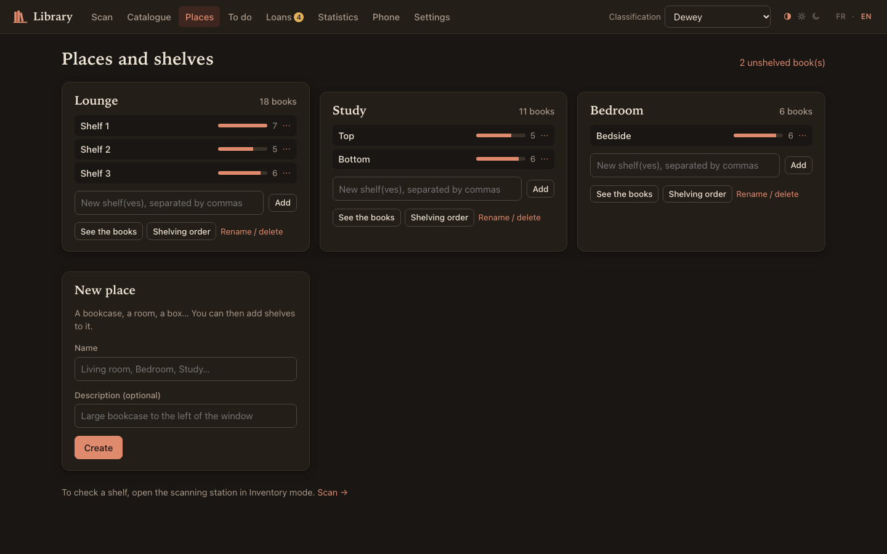
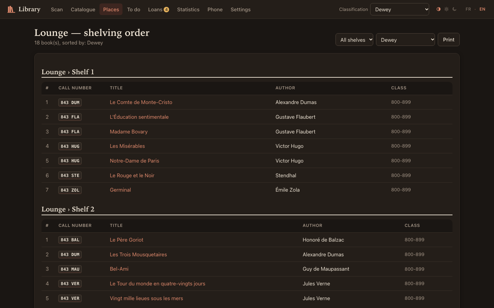
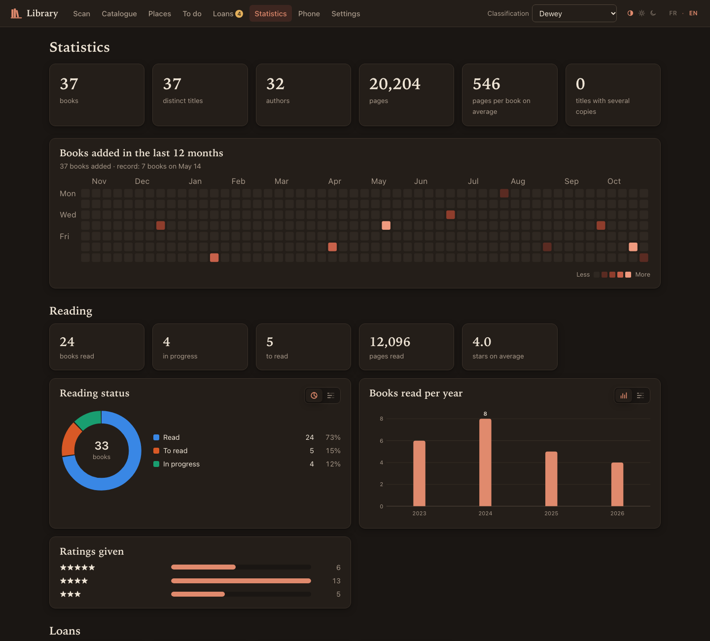
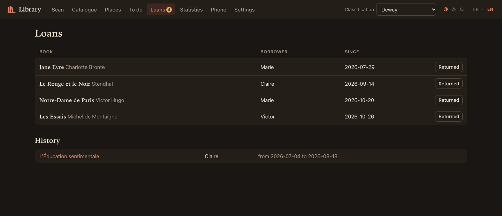

# Bibliothèque

**English** · [Français](README.fr.md)

Personal library software: scan your books with a barcode scanner, and they are described
automatically, located (Lounge › Shelf 2…) and given call numbers in seven classification
systems. A local web app for scanning and browsing, and a CLI for everything else.
Designed for macOS, Linux and Windows (tested on macOS; Linux and Windows not tried yet).

Everything is explained in the **[full documentation](DOCUMENTATION.md)**.

## Overview

Screenshots taken with a demo database: public-domain works, made-up publishers and people.



| | |
|---|---|
|  |  |
| **Scan** with a barcode scanner or your phone's camera | **Record**: reading, Markdown notes, call numbers in each system |
|  |  |
| **Places**: rooms and shelves | **Shelving**: the list to follow, shelf by shelf, ready to print |
|  |  |
| **Statistics**: additions, reading, ratings | **Loans**: who has what, and since when |

## Installation

All you need is **uv**, Astral's Python manager: it installs the right version of Python
(3.12 or later) and the dependencies by itself on first launch.

### macOS

```bash
curl -LsSf https://astral.sh/uv/install.sh | sh
```

Then, in the project folder:

```bash
./biblio.sh serve
```

`sqlite3` (for `biblio sql`) is already installed on macOS.

### Linux

```bash
curl -LsSf https://astral.sh/uv/install.sh | sh
```

```bash
./biblio.sh serve
```

For `biblio sql`, install `sqlite3` if needed (`sudo apt install sqlite3`, or `sudo dnf install sqlite`).
To scan with a phone while a firewall is active, open the phone mode ports:

```bash
sudo ufw allow 8443,8080/tcp
```

### Windows

In PowerShell:

```powershell
winget install --id=astral-sh.uv -e
```

Reopen the terminal, then in the project folder:

```powershell
.\biblio.cmd serve
```

For `biblio sql`: `winget install SQLite.SQLite` (optional). The first time you run `serve --phone`,
Windows Defender Firewall asks whether to allow Python: tick **Private networks**.

### Raspberry Pi (always-on server)

A systemd service, a database outside the network share, daily copies on an external drive, and ports
chosen so as not to disturb other services: see [deploy/README.md](deploy/README.md).

### On every system

- The browser opens at http://localhost:8000.
- The launchers `./biblio.sh` (macOS, Linux) and `biblio.cmd` (Windows) keep the Python environment
  outside the project, in `~/.virtualenvs/uv/bibliotheque`. This is useful when the folder is
  synced (OneDrive, Dropbox…). Without a launcher, `uv run biblio serve` works too: uv then creates
  a `.venv` folder in the project.
- Any command in this README is run as `./biblio.sh …` or `biblio.cmd …`; they are written
  `biblio …` below.
- Data specific to the computer (phone mode certificates): `~/Library/Application Support/biblio`
  (macOS), `%LOCALAPPDATA%\biblio` (Windows), `~/.local/share/biblio` (Linux).

First steps:
1. **Places**: create your bookcases (Lounge, Bedroom…) and their shelves.
2. **Scan**: choose the place and the shelf, then scan one book after another.
3. **To do**: complete the few books that could not be found.
4. **Catalogue**: tick books (Shift+click for a range, or “Select all N results” for a search) to
   shelve, give away or remove them in one go. Useful filters: place “Unshelved”, and the “Added” dates
   (with the “today” link).

**Theme**: at the top right, next to **FR · EN**, three small icons: automatic (follows the device's
light or dark setting), light, dark. The choice belongs to each device: the computer and the phone
can each have their own.

## Books without a barcode

- **An ISBN is printed** (often on the back of the title page, for books from the 1970s to 2000s):
  type it into the scanning station's field, as if the scanner had read it.
- **No ISBN** (old or self-published books): the “No barcode?” link under the scan field, or
  Catalogue › “+ Book without a barcode”. The page offers:
  1. a **search at the BnF** (the French national library) by title, author and year. Choosing a result
     creates a complete record with its call numbers, with no further request;
  2. a **complete description by hand** (all fields), which never depends on the BnF: if it finds
     nothing or does not answer, the title and author you typed are carried over and the book is saved
     as is. “Add and describe another one” chains books at the same location.
- From the command line: `biblio manual` (BnF search, then a numbered list; `--no-search` to enter everything
  by hand). The book receives a reference (`L12`), to type at the scanning station like an ISBN.

## Notes

Each record has a **personal note in Markdown** (headings, **bold**, lists, links, quotes…),
displayed formatted and editable in place. Notes can be searched from the catalogue,
and are never included in a shared file. CLI: `biblio note 978… [--edit]`.

## Reading and copy details

On the record, everything stays empty until you fill it in, and none of it is ever shared:

- **Reading**: to read, in progress, read or abandoned, start and end dates, a rating from 1 to 5 stars. The catalogue
  filters by status (your to-read pile), and the statistics follow your reading. CLI:
  `biblio read 978… --status read --rating 4 --finished 2026-10-30`.
- **Copy**: condition, purchase price and date, provenance, inscription, estimated value, note. The statistics give
  the value of the collection. CLI: `biblio copy 12 --condition good --price 7,50 --from Gibert`.

`biblio duplicates` lists the books you own in several copies, across all places. `--remove` removes the extra
copies at the same location, after backing up the database; a copy with details is never removed.

## Owners, gifts and friends' catalogues

Each copy has an **owner**. Your books carry your name (Settings, or
`biblio config proprietaire JD`). A person is recognised by their identity, not their name: “victor” and
“Victor” are the same person, and a friend who changes their name stays the same person.

- **Gift**: Catalogue › tick books › “Give to…”, or on the record › “Give…”. A gift only
  changes the owner: it closes a current loan, and the book leaves your shelves.
  Receiving a book works the same way (“Change owner…” › your name): it arrives
  unshelved, ready to be put away. For a loan, nothing changes: “Lend…”.
- **A friend's catalogue**: they send you a file, you import it, and the catalogue's **Owner** filter
  (My books / Victor / Everyone) then shows whether they have the book you are looking for,
  and where (“at Victor's — Lounge › S2”), unless they hid their places. By default, the catalogue, the
  statistics and “To do” only show your books.

A complete example between Victor and you (Victor uses this software too):

```bash
# At Victor's: a file with their books, without saying where they are shelved
biblio share -o for-alex.db --hide-places
```

```bash
# At your place: add it (preview, then confirmation)
biblio merge for-alex.db --as Victor
```

```bash
# Later, with a more recent file: updates, and removes the books Victor no longer has
biblio merge for-alex.db --as Victor --replace
```

The share file can also be downloaded from Settings › “Share with a friend” (choice of places,
a box to hide places). It contains the records, the call numbers and the catalogues' answers (your friend
has nothing to download again), but **never** your notes, your reading, your copy details, your Google
key, the phone key or your settings. Your loans are only included if you ask for it (`--with-loans`, or the box in Settings): they
contain the borrowers' names, and then link your friends in the loan network of the Statistics page.

**Scanning a friend's books yourself**: scan them into a separate database, then import it.
This way their places and books never mix with yours, and that database can become theirs.

```bash
# 1. Create their database, in their name (usual server stopped)
BIBLIO_DB=data/victor.db ./biblio.sh config proprietaire Victor
```

```bash
# 2. Scan at their place: create their places, then scan as usual
BIBLIO_DB=data/victor.db ./biblio.sh serve --phone
```

```bash
# 3. Once the server is stopped, add their books to your database
./biblio.sh merge data/victor.db
```

On the phone, scan the “Scan” QR code again: the key belongs to each database. Details, memory
scanners, hidden places, Windows and common errors:
[Scanning a friend's library](DOCUMENTATION.md#13-scanning-a-friends-library).

**Two computers**: each machine has its own database, and `biblio sync` brings them together. Run it on both sides.

```bash
./biblio.sh sync /path/to/the-other/biblio.db
```

The first time, the command asks you to confirm that this database really is yours. Additions, moves,
removals, loans, notes, reading, corrections and renamed places all propagate; for each piece of data, the
most recent change wins. [All the rules](DOCUMENTATION.md#syncing-two-computers).

Two commands, two needs:

| | `biblio merge`: a friend's catalogue | `biblio sync`: my two computers |
|---|---|---|
| The books | stay theirs | are mine |
| Your books | never changed | updated or removed |
| Personal data | never brought over | brought over |
| In a conflict | your corrections are kept | the most recent wins |

Rules they share: an error leaves nothing half done, merging the same file twice creates no
duplicates, `--dry-run` shows what would change, and the database is copied first (`data/biblio-avant-fusion.db`,
`data/biblio-avant-synchro.db`).

## The barcode scanner

It behaves like a keyboard: it types the code, then Enter. There is nothing to install.
- The scan field keeps the focus. High beep = added, double beep = already owned or in the wrong place, low beep = error.
- **QWERTY scanner on an AZERTY Mac**: digits arrive as `çè&é…`; this is corrected automatically.
- The price code attached to the EAN (5 extra digits) is ignored, and so is an accidental double read.
- If your scanner has a **memory mode** (scanning without a computer), export the file, then:
  `biblio import codes.txt --place "Lounge/S1"`.

### Wireless scanner

The wired version works, but a wireless scanner works **without changing anything** here.
What to look for:
- **keyboard mode (HID)**: it “types” the code like a wired scanner;
- a **2.4 GHz USB dongle** rather than Bluetooth alone: no pairing, and a more stable connection on a Mac
  (many models do both);
- **memory / inventory mode**: scan far from the computer, then empty the memory with `biblio import`;
- an adjustable keyboard layout (otherwise the AZERTY correction takes care of it) and an “Enter” suffix;
- a 1D reader (laser or CCD) is enough for book EANs; a 2D reader also reads QR codes.

## Scanning with your phone

```bash
./biblio.sh serve --phone
```

Then, on the computer, open the **Phone** page (or run `biblio phone` in the terminal):
1. **The first time**, QR code 1: installs the library's certificate on the phone
   (iPhone or Android, the instructions are displayed). This is needed because a browser only opens the
   camera over an encrypted connection.
2. **To scan**, QR code 2: opens the scanning station with the camera **in full screen**.
   Tap the screen to start (this turns on the beeps and keeps the screen awake), then aim at the
   barcodes: a beep, a green/orange/red flash, a vibration (Android), and the latest book appears
   at the bottom with its call number. Header: mode and location, tap to change them. Icons: torch,
   switch camera, leave full screen, close; an “undo” arrow under the latest addition.
   All modes work (add, move, “where is it?”, inventory).
3. **True full screen on iPhone**: from the scan page in Safari or Firefox, Share ›
   “Add to Home Screen”. The “Bibliothèque” icon then opens the scanner with no bars at all.

The beeps sound even in silent mode (music that is playing may pause);
untick the “Beeps” box to turn them off.

Details:
- Phone and computer on the same Wi-Fi. On first launch, the firewall asks whether to allow
  Python to accept incoming connections: accept (macOS; Windows: “Private networks”;
  Linux: see Installation).
- **Security**: QR code 2 contains a secret key; without it, another device on the network
  sees nothing. Phone page › “Change the key” (or `biblio phone --new-key`) cuts off
  phones that are already connected. The installation server (port 8080) only serves the
  certificate.
- The certificates and the local authority's private key are kept outside the project, in the `certs/`
  folder of the computer's data (see Installation); the server certificate renews itself
  (IP address change, expiry) with nothing to reinstall on the phone.
- Ports used: 8000 (computer), 8443 (phone, HTTPS), 8080 (installation). The last two can be changed
  with `serve --phone-port … --install-port …` (or `BIBLIO_PORT_HTTPS` / `BIBLIO_PORT_INSTALLATION`).
- Barcodes are decoded on the phone: natively on Android (Chrome), otherwise with
  `zxing-wasm`, bundled in `biblio/web/static/vendor/` (no external service).

**Network outage**: a scan that does not reach the server is kept on the device, then sent by itself, in
order, when the connection returns (a notice on screen, an “Undo” button on each one). Kept scans survive
closing the page, but the page must already be open to keep scanning offline.

Scanning station modes: **Add**, **Move** (the book joins the chosen location),
**Where is it?**, **Inventory** (scan a shelf; the report lists what is missing, books
from elsewhere and unknown books, and can put everything back in order).

## Where the descriptions come from

There is no daily quota: each catalogue is queried at a polite pace of about one
request per second, in the background. Allow 4 to 7 seconds per book, or 2 to 4 hours
for 2,000 books. Scanning never waits for the network.

| Source | Role |
|---|---|
| **BnF** (general catalogue, UNIMARC) | Main source for French books. Provides the Dewey number for non-fiction and the “cadre de classement” (classification framework) for fiction. |
| **Open Library** | Covers, English-language books, additional Dewey and LCC numbers. |
| **Library of Congress** | LCC and Dewey numbers for non-French books. |
| **Google Books** | Optional, only with a free API key (Settings). Without a key, its anonymous quota is saturated. |

Each raw answer is kept (table `raw_responses`). An ISBN is therefore never queried again,
and all records and call numbers can be recomputed without a network
(`biblio reclassify --reread`). Covers are downloaded once into `data/covers/`;
if a catalogue has no image, the next one is tried (`biblio covers --missing` retries books without an image).

## Classification systems

All call numbers are computed and stored for each book: switching systems
(the “Classification” menu) is instant.

| System | Used by | Where the call number comes from |
|---|---|---|
| **Dewey** (default) | Public libraries | BnF/Open Library for non-fiction. For novels, comics and children's books (the BnF does not index them in Dewey): inferred from the original language and the genre (French novel = 843, translated from English = 823, comics = 741.5, children's = “J 843”). |
| **BnF framework** | French national bibliography | Provided by the BnF; close to the sections of a bookshop. |
| **UDC** | Belgium, Switzerland, school libraries | Inferred from Dewey (821.133.1-31 = French novel). |
| **LCC** | English-speaking university libraries | Full call number for English-language books; otherwise an inferred subclass. |
| **Clil** | French booksellers | **Inferred** (family › subfamily): the official Clil code is distributed by Electre/Dilicom, which are paid services. |
| **Thema** | International book trade | **Inferred**, main categories. |
| **Custom sections** | Your own system | Rules you can edit in `rules/rayons.toml`. |

The official Dewey captions belong to OCLC and are not provided: books are grouped by range of hundreds (`800-899`). To display your own captions, add a `[libelles]` table to `rules/dewey.toml`, then run `biblio reclassify`.

The call number follows library practice: a class number + the first 3 letters of the author (`843 CAM`).

**Correcting**: on a book's record, each call number can be set by hand, and each
corrected field (title, form, audience…) is protected from automatic updates.

**Adapting the rules**: everything is in `rules/*.toml` (Dewey, UDC and LCC tables, Clil/Thema/custom
section rules, keyword lists). After a change: `biblio reclassify`
or Settings › “Recompute all call numbers”.

Known limitation: for French novels, the BnF does not give the subgenre (crime,
science fiction…). It is guessed from the collection (Série noire, Folio SF…) and from Open Library
subjects, so it is imperfect. Correct it by hand or enrich `rules/mots.toml`.

## The CLI (“the heart of the reactor”)

The command line is entirely in English (commands, options, messages).
The web interface is in French by default, or in English: Settings, or the
small **FR · EN** selector at the top right of every page.

```bash
./biblio.sh --help
```

(`biblio.cmd --help` on Windows.)

| Command | Role |
|---|---|
| `place add Lounge` · `place shelf Lounge S1 S2` · `place list` · `place rename` · `place remove` | Places and shelves |
| `scan --place "Lounge/S1"` | Scan in the terminal (`:place`, `:mode move`, `:undo`, `:q`) |
| `import codes.txt --place Lounge` | Import a list of ISBNs |
| `resolve [--retry]` | Describe pending books / retry those not found |
| `search camus [--since 2026-10-31] [--owner Victor\|all] [--reading to-read]` · `where 9782070360024` · `show 978…` | Search, locate, see everything |
| `list --system rayon --place Lounge` | Shelving order |
| `edit 978… --form fiction --audience adulte` | Correct a record |
| `classify 978… dewey 843.914` | Force a call number (no value: back to automatic) |
| `move 978… "Bedroom/S2"` · `inventory "Lounge/S1"` | Shelve, check |
| `lend 978… Marie` · `return 978…` · `loans` | Loans |
| `give 978… Victor` · `owners` | Give a book, see the owners |
| `share -o file.db [--hide-places] [--place Lounge] [--with-loans] [--force]` · `merge file.db [--as Victor] [--replace] [--dry-run]` | Share, import a friend's catalogue |
| `sync other.db [--dry-run]` | Bring together my databases from two computers |
| `read 978… [--status …] [--rating …] [--started …] [--finished …]` · `copy N [--condition …] [--price …] [--from …]…` | Reading, copy details |
| `note 978… [--edit]` | A book's Markdown note |
| `manual [--no-search]` · `remove <copy number>` | Book without a barcode, remove a copy |
| `system rayon` · `config google_api_key …` · `config langue en` · `config proprietaire JD` | Settings |
| `reclassify [--reread]` · `covers [--missing]` | Recompute without a network, missing covers |
| `backup [--dir FOLDER] [--keep N]` | Backup copy of the database |
| `serve [--phone]` · `phone [--new-key] [--admin]` | Web app, phone scanning, QR codes, admin key (server) |
| `todo` · `stats` · `export --format xlsx` | To do, figures, Excel export (one sheet per place) |
| `sql` · `sql "select …"` | Direct SQLite shell |

## Data

- Database: `data/biblio.db` (SQLite). Main tables: `personnes` (owners, borrowers),
  `notices` (the book, with or without an ISBN, the note and the reading), `exemplaires` (the object, its owner, its place,
  its details), `classifications` (one call number per system), `raw_responses` (catalogue answers), `lieux`,
  `etageres`, `mouvements`, `inventaires`, `prets`, `suppressions` (what syncing must not bring back).
- **Backups**: `biblio serve` copies the database to `data/sauvegardes/` once a day, and `biblio backup`
  does it on demand. The last 14 copies are kept. These are what you should restore:
  [how to do it](DOCUMENTATION.md#backing-up).
- A synced folder (OneDrive…) is not a backup: while in use, the database lives in three
  files that syncing copies separately. Do not open the app on two computers at once, and
  wait for syncing to finish before switching machines.
- `BIBLIO_DB=/other/path.db biblio …` uses another database (for trials). On Windows:
  `$env:BIBLIO_DB = "C:\path\trial.db"` (PowerShell) before the command.
- Database structure: the software is in development, and no older version is maintained. It refuses
  to open a database from another version, without changing it.

## Tests

```bash
uv run pytest
```

No network needed: the parsers are tested on real answers recorded in `tests/fixtures/`.

## License

Copyright © 2026 the biblio contributors.

This is free software, under the **GNU AGPL-3.0 or later** (see [LICENSE](LICENSE)). If you
modify it and offer it to others over a network, you must give them access to the source code of your version.

Third-party components: see [`LICENCES.txt`](biblio/web/static/vendor/LICENCES.txt).

The classifications remain the property of their owners, and the license above grants no rights
over them: Dewey, Dewey Decimal Classification and DDC are trademarks of OCLC; Thema belongs to EDItEUR, UDC
to the UDC Consortium, Clil to the Commission de liaison interprofessionnelle du livre, the classification framework
to the BnF and LCC to the Library of Congress. This project is not affiliated with any of these organizations. The tables in
`rules/` are approximate mappings: they do not replace the official editions.
