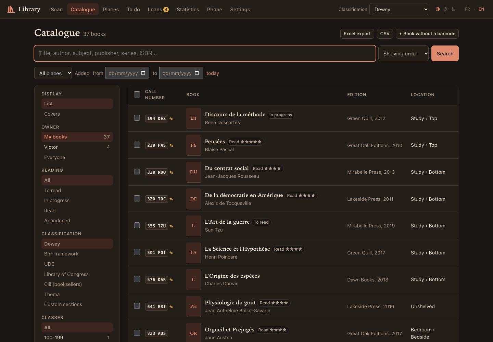
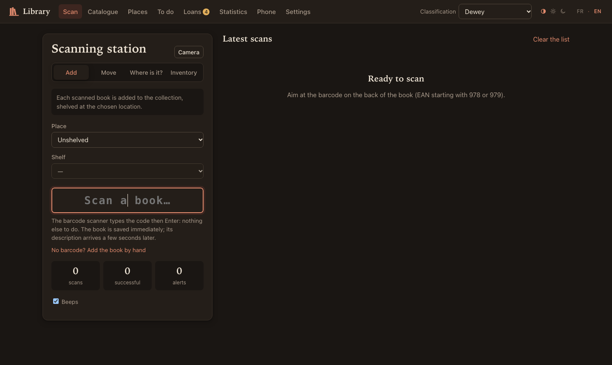
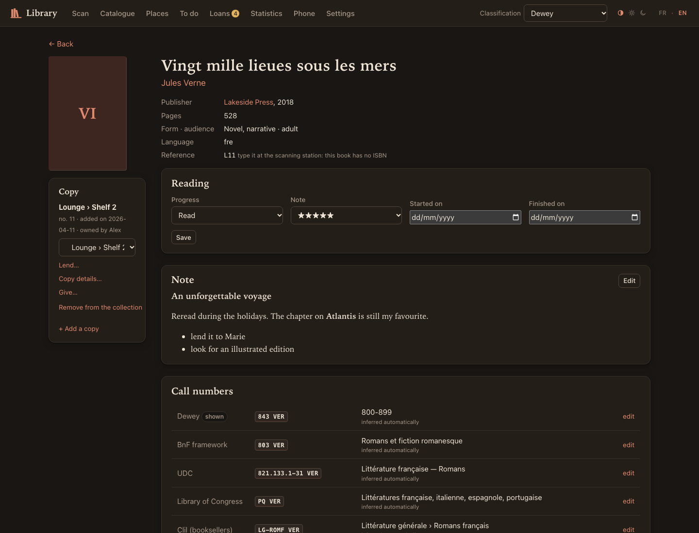
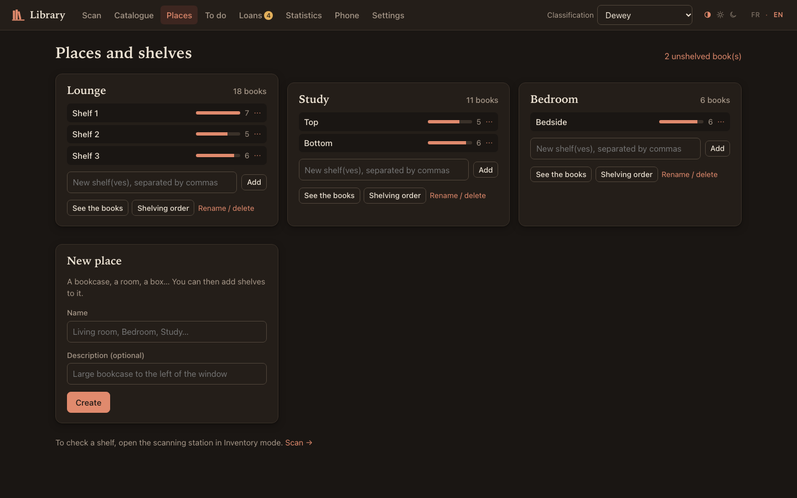
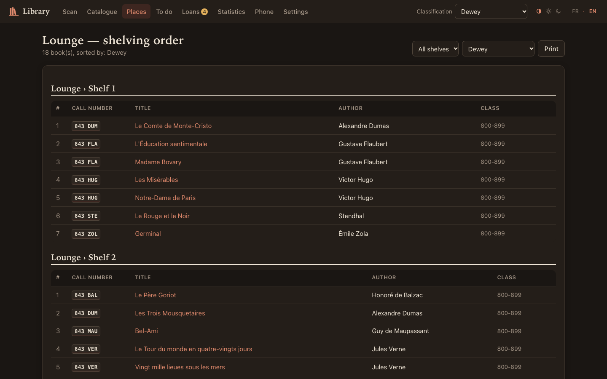
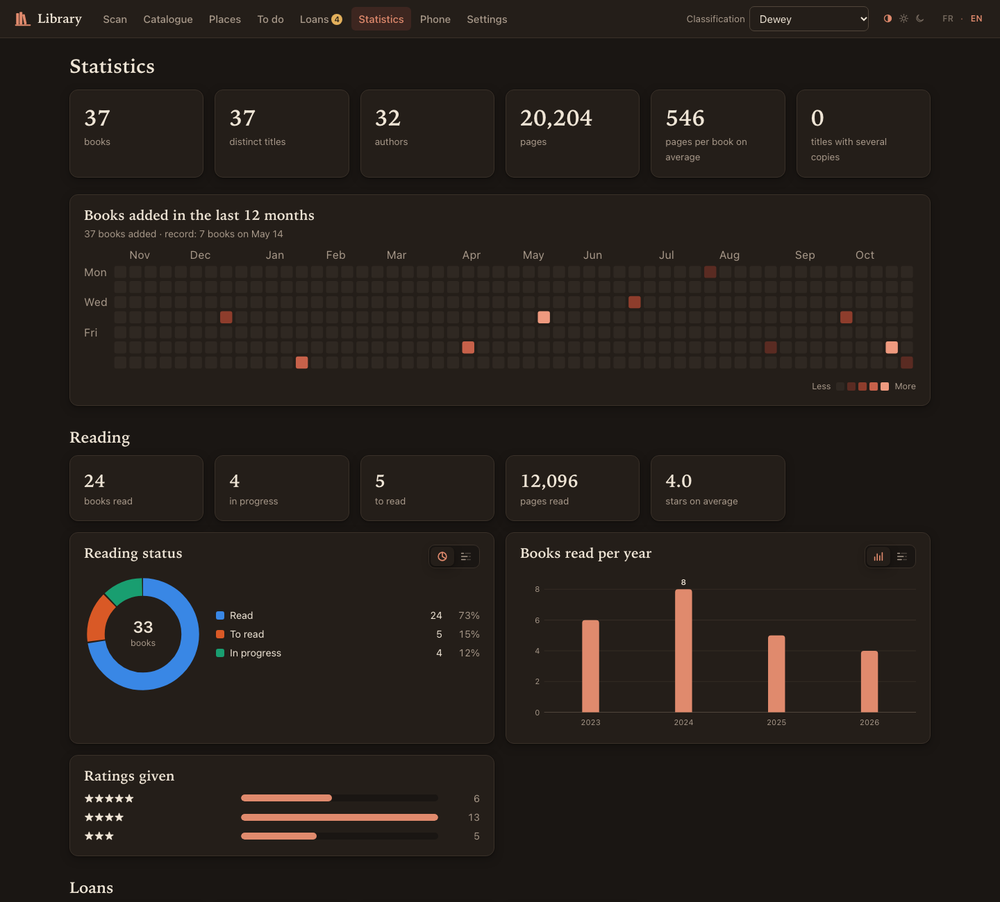
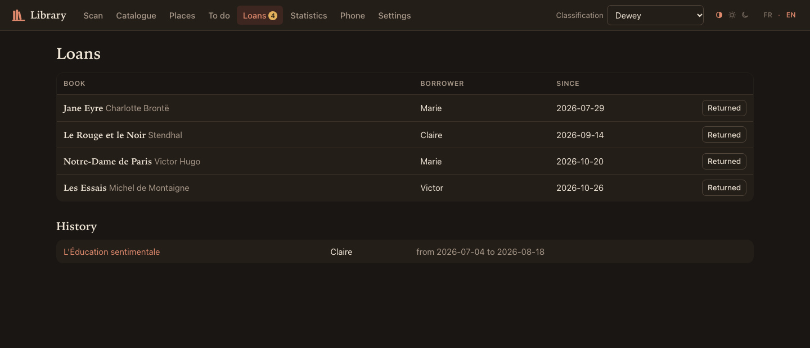

# Bibliothèque

**English** · [Français](README.fr.md)

Personal library software: scan your books, records and films with a barcode scanner, and they are
described automatically, located (Lounge › Shelf 2 › Front…) and given call numbers in seven
classification systems. A web app for scanning and browsing, with accounts and roles for the
household, and a CLI for everything else.
Designed for macOS, Linux and Windows: used every day on macOS and on a small Linux server; all tests
also pass on Linux and Windows on every push, but real use on Windows has not been tried yet.

Everything is explained in the **[full documentation](DOCUMENTATION.md)**.

## Overview

Screenshots taken with a demo database: public-domain works, made-up publishers and people.



| | |
|---|---|
|  |  |
| **Scan** with a barcode scanner or your phone's camera | **Record**: reading, Markdown notes, call numbers in each system |
|  |  |
| **Places**: rooms and shelves | **Shelving**: the list to follow, shelf by shelf, ready to print |
|  |  |
| **Statistics**: additions, reading, ratings | **Loans**: who has what, and since when |

## Installation

All you need is **uv**, Astral's Python manager: it installs the right version of Python
(3.12 or later) and the dependencies by itself on first launch.

### macOS

```bash
curl -LsSf https://astral.sh/uv/install.sh | sh
```

Then, in the project folder:

```bash
./biblio.sh serve
```

`sqlite3` (for `biblio sql`) is already installed on macOS.

### Linux

```bash
curl -LsSf https://astral.sh/uv/install.sh | sh
```

```bash
./biblio.sh serve
```

For `biblio sql`, install `sqlite3` if needed (`sudo apt install sqlite3`, or `sudo dnf install sqlite`).
To scan with your phone while a firewall is active, open the phone mode ports:

```bash
sudo ufw allow 8443,8080/tcp
```

### Windows

In PowerShell:

```powershell
winget install --id=astral-sh.uv -e
```

Reopen the terminal, then in the project folder:

```powershell
.\biblio.cmd serve
```

For `biblio sql`: `winget install SQLite.SQLite` (optional). On the first `serve --phone`,
the Windows Defender firewall asks to allow Python: tick **Private networks**.

### Always-on Linux server

To scan with your phone without switching the computer on: a systemd service on any Linux server
(mini-PC, NAS, single-board computer…), archived daily backups, synchronisation with your computer:
see [deploy/README.md](deploy/README.md).

### On every system

- The browser opens at http://localhost:8000.
- The launchers `./biblio.sh` (macOS, Linux) and `biblio.cmd` (Windows) keep the Python environment
  outside the project, in `~/.virtualenvs/uv/bibliotheque`. This is useful when the folder is
  synced (OneDrive, Dropbox…). Without a launcher, `uv run biblio serve` works too: uv then creates
  a `.venv` folder in the project.
- Any command in this README is run as `./biblio.sh …` or `biblio.cmd …`; they are written
  `biblio …` below.
- Data specific to the computer (phone mode certificates): `~/Library/Application Support/biblio`
  (macOS), `%LOCALAPPDATA%\biblio` (Windows), `~/.local/share/biblio` (Linux).

First steps:
1. **Places**: create your bookcases (Lounge, Bedroom…), their shelves and, if needed, their rows.
2. **Scan**: choose the place and the shelf, then scan one item after another.
3. **To do**: complete the few books that could not be found.
4. **Catalogue**: tick books (Shift+click for a range, or “select all results” of a search) to
   shelve, give away or remove them in one go. Useful filters: place “Unshelved”, and “Added from … to …”
   (with the “today” link).

**Theme**: at the top right, next to **FR · EN** (in the ☰ menu on a phone), three small icons: automatic
(follows the device's light or dark setting), light, dark. The choice belongs to each device: the computer
and the phone can each have their own.

## Discs and films

CDs, vinyls, cassettes, DVDs and Blu-rays are scanned like books. Tracks, label and cover come from
MusicBrainz, Discogs, Deezer and iTunes. Films need a free TMDb or OMDb key (Administration › Catalogues);
identifying them by barcode remains the least reliable: correct the title on the record, then query the
catalogues again. [Details](DOCUMENTATION.md#22-discs-and-films).

## Accounts and administration

**Administration › Accounts**: give everyone a login and a code, which they type **once per device**.
The device stays signed in until you cut it off.

| | Reader | Contributor | Librarian | Admin |
|---|---|---|---|---|
| Catalogue, records, “where is it?” | yes | yes | yes | yes |
| Scan, shelve, inventory | | yes | yes | yes |
| Edit, places, loans, exports; see notes, prices, borrowers, statistics | | | yes | yes |
| Settings, Phone, sharing, administration | | | | yes |

The **Administration** page gathers the server's health, the accounts and their devices, the state of each
catalogue and its keys, the network keys, the log and the backups. The certificates, the QR code key and the admin
key keep working; `localhost` remains an administrator. Reading status and notes are shared by the household.
[Details](DOCUMENTATION.md#23-accounts-roles-and-signing-in).

## Rows and labels

A shelf can have rows (Places › ⋯), which are optional. **Places › Labels to print** gives a barcode for each
place, shelf and row: scanning it chooses the location, then you scan the books.

## Books without a barcode

- **An ISBN is printed** (often on the back of the title page, for books from the 1970s to 2000s):
  choose “By hand” at the scanning station and type it, as if the scanner had read it.
- **No ISBN** (old or self-published books): the “No barcode?” button, under “By hand” at the scanning station.
  The page offers:
  1. a **search at the BnF** (the French national library) by title, author and year. Choosing a result
     creates a complete record with its call numbers, with no further request;
  2. a **complete description by hand** (all fields), which never depends on the BnF: if it finds
     nothing or does not answer, the title and author you typed are carried over and the book is saved
     as is. “Add and describe another one” chains books at the same location.
- From the command line: `biblio manual` (BnF search, then a numbered list; `--no-search` to enter everything
  by hand). The book receives a reference (`L12`), to type at the scanning station like an ISBN.

## Notes

Each record has a **personal note in Markdown** (headings, **bold**, lists, links, quotes…),
displayed formatted and editable in place. Notes can be searched from the catalogue,
and are never included in a shared file. CLI: `biblio note 978… [--edit]`.

## Reading and copy details

On the record, everything stays empty until you fill it in, and none of it is ever shared:

- **Reading**: to read, reading, read or abandoned, start and end dates, a rating from 1 to 5 stars. The catalogue
  filters by status (your to-read pile), and the statistics follow your reading. CLI:
  `biblio read 978… --status read --rating 4 --finished 2026-10-30`.
- **Copy**: condition, purchase price and date, where it came from, inscription, estimated value, note. The statistics
  give the value of the collection. CLI: `biblio copy 12 --condition good --price 7,50 --from Gibert`.

`biblio duplicates` lists the books you own in several copies, across all places. `--remove` removes the extra
copies at the same location, after copying the database; a copy with details filled in is never removed.

## Owners, gifts and friends' catalogues

Each copy has an **owner**. Your books carry your name (Settings, or
`biblio config proprietaire JD`). A person is recognised by their identity, not their name: “victor” and
“Victor” are the same person, and a friend who changes their name stays the same person.

- **Gift**: Catalogue › tick books › “Give to…”, or on the record › “Give…”. A gift
  only changes the owner: it closes a current loan, and the book leaves your shelves.
  Receiving a book works the same way (“Change owner…” › your name): it arrives
  unshelved, ready to be put away. For a loan, nothing changes: “Lend…”.
- **A friend's catalogue**: they send you a file, you import it, then the catalogue's **Owner** filter
  (Mine / Victor / Everyone) shows whether they have the book you are looking for,
  and where (“at Victor's — Lounge › S2”), unless they hid their places. By default, the catalogue, the
  statistics and “To do” only show your books.

A complete example between Victor and you (Victor uses this software too):

```bash
# At Victor's: a file with their books, without saying where they are shelved
biblio share -o for-alex.db --hide-places
```

```bash
# At your place: add it (preview, then confirmation)
biblio merge for-alex.db --as Victor
```

```bash
# Later, with a more recent file: updates, and removes the books Victor no longer has
biblio merge for-alex.db --as Victor --replace
```

The shared file can also be downloaded from Settings › “Share with a friend” (choice of places,
“hide places” box). It contains the records, the call numbers and the catalogues' answers (the friend
has nothing to download again), but **never** your notes, your reading, your copies' details, your
Google key, the phone key or your settings. Your loans are only included if you ask (`--with-loans`, or the box
in Settings): they contain the borrowers' names, and then link your friends in the loan network of the Statistics.

**Scanning a friend's books yourself**: scan them into a separate database, then import it.
Their places and books never mix with yours, and that database can later become theirs.

```bash
# 1. Create their database, in their name (usual server stopped)
BIBLIO_DB=data/victor.db ./biblio.sh config proprietaire Victor
```

```bash
# 2. Scan at their place: create their places, then scan as usual
BIBLIO_DB=data/victor.db ./biblio.sh serve --phone
```

```bash
# 3. Once the server is stopped, add their books to your database
./biblio.sh merge data/victor.db
```

On the phone, scan the “Scan” QR code again: the key belongs to each database. Details, scanners with
memory, hidden places, Windows and common errors:
[Scanning a friend's library](DOCUMENTATION.md#13-scanning-a-friends-library).

**Two computers**: each machine has its own database, and `biblio sync` brings them together. Run it on both sides.

```bash
./biblio.sh sync /path/to/the-other/biblio.db
```

The first time, the command asks you to confirm that this database really is yours. Additions, moves,
removals, loans, notes, reading, corrections and renamed places are propagated; for each piece of data, the
most recent change wins. [All the rules](DOCUMENTATION.md#syncing-two-computers).

Two commands, two needs:

| | `biblio merge`: a friend's catalogue | `biblio sync`: my two computers |
|---|---|---|
| The books | stay theirs | are mine |
| Your books | never changed | updated, or removed |
| Personal data | never taken | taken |
| In case of conflict | your corrections kept | the most recent wins |

Common rules: an error leaves nothing half done, merging the same file twice creates no
duplicate, `--dry-run` shows what would change, and the database is copied first (`data/biblio-avant-fusion.db`,
`data/biblio-avant-synchro.db`).

## The barcode scanner

It behaves like a keyboard: it types the code then Enter. Nothing to install. Choose **Barcode scanner** at the
top of the scanning station (the other choices: **Camera** and **By hand**).
- You chain books without touching the screen or the mouse. High beep = added, double beep = already owned or
  misplaced, low beep = error.
- **Keyboard layout**: only the physical key counts, in QWERTY as in AZERTY, on a computer as on a phone.
- **Pocket mode** (phone): screen on but black, touches ignored, beeps kept. A web page receives nothing while the
  screen is locked: only the phone's beep proves the scan was saved, not the scanner's.
- The price code stuck to the EAN (5 more digits) is ignored, and so is an accidental double read.
- If your scanner has a **memory mode** (scanning away from the computer), export the file then:
  `biblio import codes.txt --place "Salon/É1"`.

### Wireless scanner

The wired version works, but a wireless scanner works **without changing anything** here.
What to look for:
- **keyboard mode (HID)**: it “types” the code like a wired scanner;
- **2.4 GHz USB dongle** rather than Bluetooth only: no pairing, a steadier connection on a Mac
  (many models do both);
- **memory / inventory mode**: you scan away from the computer, then empty the memory with `biblio import`;
- adjustable keyboard layout (otherwise the AZERTY correction takes care of it) and an “Enter” suffix;
- a 1D reader (laser or CCD) is enough for books' EANs; a 2D one also reads QR codes.

## Scanning with your phone

```bash
./biblio.sh serve --phone
```

Then, on the computer, the **Phone** page (or `biblio phone` in the terminal):
1. **The first time**, QR code 1: installs the library's certificate on the phone
   (iPhone or Android, the instructions are shown). Needed because the browser only opens the
   camera over an encrypted connection.
2. **To scan**, QR code 2: opens the scanning station with the camera **full screen**.
   Touch the screen to start (enables the beeps and keeps the screen on), then aim at the
   barcodes: beep, green/orange/red flash, vibration (Android), and the last item is shown
   at the bottom with its call number. Header: mode and location, touch them to change them. Icons: torch,
   switch camera, leave full screen, close; “undo” arrow under the last addition.
   Every mode works (add, move, “where is it?”, inventory).
3. **True full screen on iPhone**: from the scan page in Safari or Firefox, Share ›
   “Add to Home Screen”. The “Bibliothèque” icon then opens the scanner without any bar.

The beeps sound even in silent mode (music that is playing may pause);
“Beeps” box or the camera's speaker button to turn them off.

Details:
- Phone and computer on the same Wi-Fi. On first launch, the firewall asks to allow
  Python to accept incoming connections: accept (macOS; Windows: “Private networks”;
  Linux: see Installation).
- **Security**: QR code 2 contains a secret key; without it or an account, another device on the network
  sees nothing. Phone page › “Change the key” (or `biblio phone --new-key`) cuts off
  the phones already connected. The installation server (port 8080) only serves the
  certificate.
- The certificates and the local authority's private key are stored outside the project, in the
  `certs/` folder of the computer's data (see Installation); the server certificate renews itself
  (change of IP address, expiry) without reinstalling anything on the phone.
- Ports used: 8000 (computer), 8443 (phone, HTTPS), 8080 (installation). The last two can be changed
  with `serve --phone-port … --install-port …` (or `BIBLIO_PORT_HTTPS` / `BIBLIO_PORT_INSTALLATION`).
- Barcodes are decoded in the phone: natively on Android (Chrome), otherwise with
  `zxing-wasm` bundled in `biblio/web/static/vendor/` (no external service).

**Network outage**: a scan that does not reach the server is kept on the device, then leaves by itself, in
order, when the connection comes back (shown on screen, with an “Undo” button on each). Kept scans survive
closing the page, but the page must already be open to keep scanning offline.

Scanning station modes: **Add**, **Move** (the item joins the chosen location),
**Where is it?**, **Inventory** (you scan a shelf; the report lists the missing books, the
books from elsewhere and the unknown ones, and can put everything back in order).

## Where the descriptions come from

No daily quota: each catalogue is queried at a polite pace of about one
request per second, in the background. Count 4 to 7 seconds per book, i.e. 2 to 4 hours
for 2,000 books. Scanning never waits for the network.

| Source | Role |
|---|---|
| **BnF** (general catalogue, UNIMARC) | Main source for French books. Provides the Dewey number of non-fiction and the “classification framework” for fiction. |
| **Open Library** | Covers, English-language books, additional Dewey and LCC. |
| **Library of Congress** | LCC and Dewey for non-French books. |
| **Sudoc** | French university libraries: completes the BnF, often with a Dewey number even for fiction. |
| **K10plus**, **DNB** | German libraries, for books found nowhere else. |
| **Google Books** | Optional, only with a free API key (Administration › Catalogues). Without a key, its anonymous quota is often exhausted. |
| **MusicBrainz**, **Discogs**, **Deezer**, **iTunes** | Records. |
| **UPCitemdb**, **TMDb**, **OMDb** | Films (TMDb and OMDb with a free key). |

Each raw answer is kept (table `raw_responses`). An ISBN is therefore never queried twice,
and all records and call numbers can be recomputed without the network
(`biblio reclassify --reread`). Covers are downloaded once into `data/covers/`;
if a catalogue has no image, the next one is tried (`biblio covers --missing` retries the books without an image).

## Classification systems

All call numbers are computed and stored for each book: switching systems
(“Classification” menu) is instant.

| System | Used by | Origin of the call number |
|---|---|---|
| **Dewey** (default) | Public libraries | BnF/Open Library for non-fiction. For novels, comics and children's books (the BnF does not index them in Dewey): deduced from the original language and the genre (French novel = 843, translated from English = 823, comics = 741.5, children's = “J 843”). |
| **BnF framework** | French national bibliography | Provided by the BnF; close to a bookshop's sections. |
| **UDC** | Belgium, Switzerland, school libraries | Deduced from Dewey (821.133.1-31 = French novel). |
| **LCC** | English-speaking university libraries | Full call number for English-language books; otherwise a deduced subclass. |
| **Clil** | French booksellers | **Deduced** (family › sub-family): the official Clil code is distributed by Electre/Dilicom, paid services. |
| **Thema** | International book trade | **Deduced**, main categories. |
| **Custom sections** | Your own system | Editable rules in `rules/rayons.toml`. |

The official Dewey captions belong to OCLC and are not provided: books are grouped by range of hundreds (`800-899`). To show your own captions, add a `[libelles]` table to `rules/dewey.toml`, then run `biblio reclassify`.

The call number follows library practice: class number + first 3 letters of the author (`843 CAM`).

**Correcting**: on a book's record, each call number can be set by hand, and each
corrected field (title, form, audience…) is protected from automatic updates.

**Adapting the rules**: everything is in `rules/*.toml` (Dewey, UDC and LCC tables,
Clil/Thema/custom section rules, keyword lists). After a change: `biblio reclassify`
or Settings › “Recompute all call numbers”.

Known limitation: for French novels, the BnF does not give the sub-genre (crime,
SF…). It is guessed from the series (Série noire, Folio SF…) and from Open Library's
subjects, hence imperfect. Correct it by hand or enrich `rules/mots.toml`.

## The CLI (“the heart of the reactor”), in English

The command line is entirely in English (commands, options, messages).
The web interface is in French by default, or in English: Settings, or the
small **FR · EN** selector at the top right of every page (in the ☰ menu on a phone).

```bash
./biblio.sh --help
```

(`biblio.cmd --help` on Windows.)

| Command | Role |
|---|---|
| `place add Salon` · `place shelf Salon É1 É2` · `place row Salon/É1 Devant` · `place list` · `place rename` · `place remove` | Places, shelves and rows |
| `scan --place "Salon/É1"` | Scan in the terminal (`:place`, `:mode move`, `:undo`, `:q`) |
| `import codes.txt --place Salon` | Import a list of ISBNs |
| `resolve [--retry]` | Describe the pending books / retry the ones not found |
| `search camus [--since 2026-10-31] [--owner Victor\|all] [--reading to-read]` · `where 9782070360024` · `show 978…` | Search, locate, see everything |
| `list --system rayon --place Salon` | Shelving order |
| `edit 978… --form fiction --audience adulte` | Correct a record |
| `classify 978… dewey 843.914` | Force a call number (without a value: back to automatic) |
| `move 978… "Chambre/É2"` · `inventory "Salon/É1"` | Shelve, check |
| `lend 978… Marie` · `return 978…` · `loans` | Loans |
| `give 978… Victor` · `owners` | Give a book away, see the owners |
| `share -o file.db [--hide-places] [--place Salon] [--with-loans] [--force]` · `merge file.db [--as Victor] [--replace] [--dry-run]` | Share, import a friend's catalogue |
| `sync other.db [--dry-run]` | Bring together my databases from two computers |
| `read 978… [--status …] [--rating …] [--started …] [--finished …]` · `copy No. [--condition …] [--price …] [--from …]…` | Reading, copy details |
| `note 978… [--edit]` | A book's Markdown note |
| `manual [--no-search]` · `remove <copy no.>` | Book without a barcode, remove a copy |
| `system rayon` · `config google_api_key …` · `config langue en` · `config proprietaire JD` | Settings |
| `reclassify [--reread]` · `covers [--missing]` | Recompute without the network, missing covers |
| `backup [--dir FOLDER] [--keep N]` | Backup copy of the database |
| `serve [--phone]` · `phone [--new-key] [--admin]` | Web app, phone scanning, QR codes, admin key (server) |
| `todo` · `stats` · `export --format xlsx` | To do, figures, Excel export (one sheet per place) |
| `export --format goodreads` · `export --format babelio` · `import-babelio FILE` | Files for reading apps, statuses and ratings taken from Babelio |
| `sql` · `sql "select …"` | Direct SQLite shell |
| `user add NAME --role admin` · `user list` · `user reset NAME` · `user disable NAME` | Accounts |
| `sources` | Tests each catalogue |

## Data

- Database: `data/biblio.db` (SQLite). Main tables: `personnes` (owners, borrowers),
  `notices` (the book, record or film, with or without a barcode, the note and the reading), `exemplaires` (the object,
  its owner, its place, its details), `classifications` (one call number per system), `raw_responses` (the
  catalogues' answers), `lieux`, `etageres`, `rangees`, `comptes`, `sessions`, `journal`, `mouvements`, `inventaires`,
  `prets`, `suppressions` (what synchronisation must not bring back).
- **Backups**: `biblio serve` copies the database into `data/sauvegardes/` once a day, and `biblio backup`
  does it on demand. The last 14 copies are kept. These are the ones to restore:
  [how to](DOCUMENTATION.md#backing-up).
- A synced folder (OneDrive…) is not a backup: while in use, the database lives in three
  files that synchronisation copies separately. Do not open the app on two computers at the same time, and
  wait for synchronisation to finish before switching machines.
- `BIBLIO_DB=/other/path.db biblio …` lets you use another database (for trials). On Windows:
  `$env:BIBLIO_DB = "C:\path\trial.db"` (PowerShell) before the command.
- Database structure: the software is in development, no older version is maintained. It refuses
  to open a database from another version, without changing it.

## Tests

```bash
uv run pytest
```

Without the network: the parsers are tested on real answers recorded in `tests/fixtures/`.

## License

Copyright © 2026 the biblio contributors.

This is free software, under the **GNU AGPL-3.0 or later** (see [LICENSE](LICENSE)). If you
modify it and offer it to others over a network, you must give them access to the source code of your version.

Third-party components: see [`LICENCES.txt`](biblio/web/static/vendor/LICENCES.txt).

The classifications remain the property of their owners, and the license above grants no rights
over them: Dewey, Dewey Decimal Classification and DDC are trademarks of OCLC; Thema belongs to EDItEUR, UDC
to the UDC Consortium, Clil to the Commission de liaison interprofessionnelle du livre, the classification framework
to the BnF and LCC to the Library of Congress. This project is not affiliated with any of these organizations. The tables in
`rules/` are approximate mappings: they do not replace the official editions.
